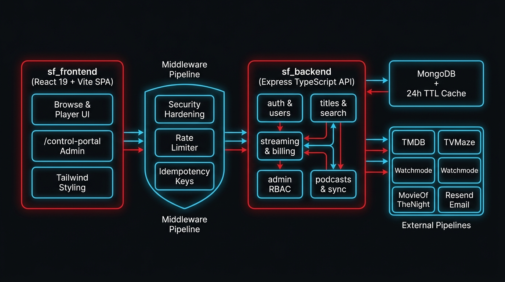
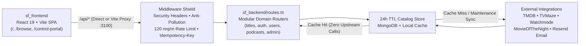

# Stream Flix Streaming Platform & Modular Service Architecture



A decoupled, streaming platform and modular backend service built with **React 19**, **Node.js 24**, **TypeScript**, **Tailwind CSS**, **Express**, and multi-provider media pipelines (**TMDB**, **TVMaze**, **Watchmode**, **MovieOfTheNight**, **Resend**).

---

## End-to-End Request & Control Flow



---

## Project Structure (Monorepo)

The codebase is decoupled into independent **`sf_frontend/`** (client SPA) and **`sf_backend/`** (modular Express API) layers enforced by integration tests (`tests/separation_integration.test.ts`), alongside a unified **`server.ts`** entrypoint for single-port production deployments.

```text
stream-flix/
├── sf_frontend/                     # Decoupled React 19 + Tailwind SPA
│   ├── main.tsx                     # Client bootstrap entrypoint
│   ├── App.tsx                      # Client routing & layout shell
│   ├── index.css                    # Tailwind theme tokens & animations
│   ├── types/index.ts               # Shared frontend domain types
│   ├── lib/
│   │   ├── api/mockClient.ts        # Fetch client (supports VITE_API_BASE_URL)
│   │   ├── api/mockData.ts          # Client fallback & visual catalog defs
│   │   ├── api/dummyTitles.ts       # Maintenance-mode placeholder fixtures
│   │   ├── auth/authContext.tsx     # Session, profile & My List state
│   │   └── utils/                   # Video URL helpers & formatters
│   └── components/
│       ├── layout/                  # TopNav, Footer
│       ├── media/                   # BackdropHero, PosterCard, TitleDetailModal, PlayerShell, AudioPlayerBar
│       ├── ui/                      # MoviePosterImage, ToastContainer, CookieConsentBanner, Logo, Button
│       └── views/                   # BrowsePage, GenrePage, SearchPage, AdminDashboardPage (/control-portal), ...
├── sf_backend/                      # Decoupled Modular Express Service (streamflix-api layout)
│   ├── app.ts                       # Express app factory, static assets & middleware wiring
│   ├── server.ts                    # Standalone sf_backend server (BACKEND_PORT=3100)
│   ├── routes.ts                    # Central API router aggregator (/api/*)
│   ├── config/
│   │   ├── env.ts                   # Typed environment config & defaults
│   │   └── db.ts                    # MongoDB connection manager
│   ├── cache/cache.ts               # 24h TTL file & memory cache layer
│   ├── data/
│   │   ├── catalog.seed.ts          # Backend-owned initial catalog, plans & placeholder fixtures
│   │   └── catalog.store.ts         # Persistent catalog lookup, enrichment & maintenance toggle store
│   ├── db/
│   │   ├── mongo.storage.ts         # MongoDB persistence adapter
│   │   └── enrichTitles.ts          # Background metadata & cast hydration helpers
│   ├── integrations/
│   │   ├── tmdb.service.ts          # TMDB catalog, trailers, credits & search client
│   │   ├── tvmaze.service.ts        # TVMaze episodic series & cast roster client
│   │   ├── watchmode.service.ts     # Regional streaming availability client
│   │   ├── movieofthenight.service.ts # Streaming Availability RapidAPI client
│   │   └── resend.service.ts        # Resend transactional email & security alert service
│   ├── middleware/
│   │   ├── security.ts              # Helmet-style headers, NoSQL/prototype guard, path guard, rate limit
│   │   ├── idempotency.ts           # 1-hour Idempotency-Key replay cache for mutations
│   │   └── auth.ts                  # Token resolver (getCurrentUser) & X-Admin-Secret RBAC guard
│   └── modules/                     # Domain-isolated REST controllers
│       ├── admin/admin.routes.ts
│       ├── auth/auth.routes.ts
│       ├── availability/availability.routes.ts
│       ├── billing/billing.routes.ts
│       ├── health/health.routes.ts
│       ├── podcasts/podcasts.routes.ts
│       ├── streaming/streaming.routes.ts
│       ├── titles/titles.routes.ts
│       └── users/users.routes.ts
├── src/assets/images/               # Generated hero stills & architecture diagram
├── admin_manager/                   # CLI Shell ops (create/delete/reset admin & superuser, sync, audit)
├── scripts/                         # Selective Git push gates (push_frontend.sh, push_backend.sh, push_changed.sh)
├── tests/                           # Vitest unit, security, idempotency, email & separation suites
├── dev.sh                           # Dual-service runner with automatic busy-port kill & retry
├── server.ts                        # Unified single-port runtime (Vite middleware + sf_backend)
└── .github/workflows/ci.yml         # Node.js 24 CI pipeline with selective diff verification
```

---

## Key Architectural Capabilities

- **Zero Empty Posters & Auto-Playing Trailers**: `MoviePosterImage` renders verified movie posters and aesthetic SVG fallback badges on missing/broken assets, while `catalog.store.ts` skips posterless feeds. `BackdropHero` and `TitleDetailModal` auto-play verified trailer feeds cleanly.
- **24-Hour Persistent Cache-First Pipeline**: Lookups hit local/MongoDB storage first; upstream TMDB/TVMaze requests run only on cache miss or explicit admin sync to eliminate redundant quota burn.
- **Idempotency & Security Hardening**: All mutating requests support `Idempotency-Key` / `X-Idempotency-Key` 1-hour deduplication, prototype-pollution & `$`-operator blocking, traversal blocking (`/.env`, `/.git`, `..`), defensive headers, and sliding-window rate limiting (`120 req/min`).
- **Isolated Admin Control Portal (`/control-portal`)**: Protected operational control center for switching between **Live Movies** (`LIVE_SERVICES`) and **Dummy Maintenance Placeholders** (`DUMMY_MAINTENANCE`), syncing upstream feeds, and monitoring integration health.
- **Transactional Emails via Resend**: Sends admin onboarding alerts, password reset notifications, and security deletion notices via `RESEND_API_KEY`.

---

## Tech Stack & Prerequisites

- **Runtime**: Node.js **24** (v23+ supported)
- **Frontend**: React 19, Vite, TypeScript, Tailwind CSS, Lucide React, Motion
- **Backend**: Express, MongoDB driver, Zod, Supertest
- **Testing & CI/CD**: Vitest + Supertest, GitHub Actions (`Node 24`)

---

## Environment Configuration (Placeholders)

Copy `.env.example` to `.env` before starting services locally:

```bash
cp .env.example .env
```

Example `.env` template (never commit real credentials):

```env
# ---- Server Configuration ----
PORT="3000"
BACKEND_PORT="3100"
NODE_ENV="development"
CLIENT_URL="http://localhost:3000"

# ---- Database ----
MONGO_URI="mongodb://localhost:27017/streamflix"

# ---- External Movie & Show Providers ----
TMDB_API_KEY=""
TMDB_API_TOKEN=""
TMDB_APPLICATION_NAME="StreamFlix_Dev"
TVMAZE_BASE_URL="https://api.tvmaze.com"
WATCHMODE_API_TOKEN=""
WATCHMODE_BASE_URL="https://api.watchmode.com/v1"
MOVIEOFTHENIGHT_API_TOKEN=""
MOVIEOFTHENIGHT_BASE_URL="https://streaming-availability.p.rapidapi.com/v4"
AVAILABILITY_DEFAULT_COUNTRY="us"

# ---- Resend Email Platform ----
RESEND_API_KEY="re_dummy_placeholder_key_here"
RESEND_FROM_EMAIL="onboarding@resend.dev"

# ---- Admin / Superuser Credentials ----
ADMIN_EMAIL="admin@streamflix.local"
ADMIN_PASSWORD="ReplaceWithLocalDevPassword!"
ADMIN_SECRET_KEY="replace_with_local_admin_secret_token"
ADMIN_PORTAL_PATH="/control-portal"
```

---

## Running Locally

### Option A: Dual-Service Split Mode (`./dev.sh`) - Recommended for Separated Development
Launches standalone `sf_backend` on port `3100` and Vite `sf_frontend` on port `3000` (with `/api/*` proxied to `3100`). Automatically detects lingering busy processes on target ports, terminates them cleanly with retries, verifies `/api/health`, and shuts down both processes on Ctrl+C:

```bash
chmod +x dev.sh
./dev.sh
# Custom ports supported:
./dev.sh --frontend-port 3000 --backend-port 3100
```

### Option B: Unified Single-Port Mode (Production / Preview Runtime)
Runs Express + Vite middleware together on port `3000`:

```bash
npm install
npm run dev
```

### Production Build & Execution

```bash
npm run build:prod   # vite build + esbuild server bundle (dist/ + dist-server/)
NODE_ENV=production npm run start:prod
```

### Containerized Production Stack (app + Redis + nginx)

```bash
docker compose up -d --build   # serves the app through nginx on http://localhost:80
docker compose logs -f app
docker compose down
```

- **`Dockerfile`** — multi-stage build: `npm run build:prod` in the build stage, minimal `node:24-alpine` runtime with production deps only.
- **`docker-compose.yml`** — `app` (Express + bundled SPA on port 3000), `redis` (rate limiting + idempotency cache), `nginx` (reverse proxy on port 80, gzip, security headers, `/api/auth/*` and `/api/*` rate limits). App config is read from `.env` via `env_file`; `REDIS_URL` is overridden to the in-network `redis` service.
- **`nginx/nginx.conf`** — HTTP reverse proxy. TLS terminates upstream (VPC/ALB); add certs there when the domain is confirmed.

### Authentication Model (production)

- Passwords hashed with Node `scrypt`; credentials stored in the backend-only `auth_credentials` collection (never in the public `users` documents).
- Sessions are HS256 JWTs in **httpOnly cookies** (`sf_access_token` 15 min, `sf_refresh_token` 7 days), `SameSite=Lax`, `Secure` in production.
- Endpoints: `POST /api/auth/register`, `/api/auth/login`, `GET /api/auth/me`, `POST /api/auth/refresh`, `/api/auth/logout`, `/api/auth/change-password`, `/api/auth/forgot-password`, `/api/auth/reset-password`.
- Password change/reset/admin-reset increments `tokenVersion`, revoking all outstanding sessions.
- Email delivery (welcome/reset) is mocked until the Resend domain is verified; `POST /api/auth/forgot-password` returns a dev `resetToken` outside production.

---

## Selective Git Push & Full Integration Gatekeeper

Push changes for **only `sf_frontend`** or **only `sf_backend`** without letting unverified changes break the sibling service. Every push script **always** executes cross-service `npm run lint`, full `npm test` (including `separation_integration.test.ts`), and scoped build/boot checks before staging and pushing **only** the targeted paths:

```bash
# Auto-detects changed component (or scopes explicitly):
./scripts/push_changed.sh

# Commit & push ONLY sf_frontend changes (after full integration test pass):
./scripts/push_frontend.sh -m "feat(frontend): update title card layout"

# Commit & push ONLY sf_backend changes (after full integration test pass):
./scripts/push_backend.sh -m "feat(backend): tune catalog cache TTL"

# Dry-run verification without committing or pushing:
./scripts/push_changed.sh --frontend --dry-run
```

---

## Admin Control Portal & CLI Scripts

### Web Control Portal
Access the isolated control portal at `http://localhost:3000/#/control-portal` (aliases: `/admin-settings`, `/controller`):
- Toggle **Live Services** vs. **Dummy Maintenance Mode** (`POST /api/admin/toggle-live-movies`)
- Trigger **24h Catalog Cache Synchronization** (`POST /api/admin/sync-catalog`)
- Inspect downstream provider configuration & health (`GET /api/admin/status`)

### CLI Operations (`./admin_manager/*.sh`)
All shell tools require `ADMIN_SECRET_KEY` (loaded from `.env`) and hit protected RBAC endpoints on `sf_backend`:

```bash
./admin_manager/create_superuser.sh <email> [profileName]
./admin_manager/delete_superuser.sh <email>
./admin_manager/reset_superuser.sh <email>
./admin_manager/list_superusers.sh
./admin_manager/create_admin.sh <email> [profileName]
./admin_manager/delete_admin.sh <email>
./admin_manager/reset_admin.sh <email>
./admin_manager/list_admins.sh
./admin_manager/toggle_maintenance_mode.sh
./admin_manager/sync_catalogs.sh
./admin_manager/test_resend_email.sh <recipientEmail>
./admin_manager/security_audit.sh
```

---

## Testing, Security Verification & Postman Reference

```bash
# Run TypeScript verification across sf_frontend + sf_backend
npm run lint

# Run all 8 Vitest suites (catalog, admin RBAC, idempotency, security, storage, separation integration)
npm test
```

See **`API_ROUTES_POSTMAN.md`** for complete documentation of all 32 REST endpoints, headers (`Idempotency-Key`, `X-Admin-Secret`), request schemas, and frontend routes.

---

## CI/CD Automation (`.github/workflows/ci.yml`)

- Runs on **Node.js 24** (`node-version: '24'`).
- Validates shell scripts with `bash -n`, inspects separated component changes (`sf_frontend` / `sf_backend`), runs `npm run lint`, executes `npm test`, and verifies the production bundle (`npm run build`).
- CI runs on pushes to `staging` and on pull requests targeting `main`, `master`, or `staging`.

### Staging ship flow

```bash
./ship.sh
```

`ship.sh` commits to the `staging` branch, pushes it, waits for the `ci.yml` run tied to that commit, and only merges into `main` when CI passes. Override the branch name for a gcentrix-style flow with `STAGING_BRANCH=ray__staging ./ship.sh`.
